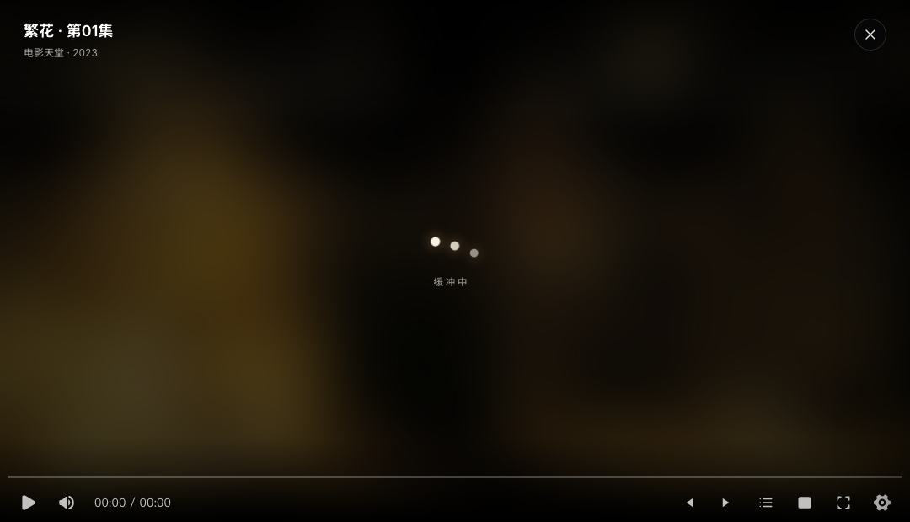

# 放映室 · NAS 个人娱乐中心

跑在 NAS 上的自托管影视 / 直播 / 音乐入口。**只用 Python 标准库**，没有 pip 依赖，也没有前端构建步骤。

搜片名 → 点开 → 直接播。片源可以在设置里像 TVBox 一样用配置地址批量导入，收藏、下载任务、播放记录都收进了设置页，主页只留内容。


---

## 功能

**影视**
- 聚合多个苹果 CMS 采集源，一次搜索同时问所有站，按片名合并去重，同一部片列出全部线路
- 片库浏览：电影 / 剧集 / 动漫 / 综艺 / 纪录片，支持年份、地区、**单个片源**筛选
- 详情页含简介、导演、主演、评分、地区、语言，可切换线路与选集
- **HLS 同源代理**：采集站基本不带 CORS 头，浏览器直连会被拦；后端代理清单与分片后，绝大多数线路能直接播
- 播放进度每 5 秒记一次，下次从「继续观看」续播


详情页的每条线路带**画质徽标**（4K / 1080P / 720P / HD / 480P）。
初始值从采集站备注里认，页面打开后会并发探测前 8 条线路的 m3u8 主列表，
用真实 `RESOLUTION` 覆盖猜测值，并按画质重排（默认选中最高画质那条）。
播放器标题旁还会显示解码出来的真实分辨率。

播放页的鼠标/触摸语义：**单击画面 = 播放/暂停（立即响应），双击画面 = 全屏/退出全屏**。
单击时画面中央给一个毛玻璃圆 + 状态图标（暂停时常驻，恢复播放后自动淡出）；
双击时第一下的切换会被撤销，也不会留下任何图标。
缓冲时画面不是纯黑：背后是这张片子的**模糊海报**，中间是三个依次跳起的**波点**，
下面跟「缓冲中 · 进度 · 网速」——不做转圈，也不做常驻进度条；
**打画中画后播放层会自动收起**，
回到详情页或任意页面继续浏览（导航、收藏、搜索都能用），小窗接着播。
点小窗上的「返回标签页」画面会自动收回大屏，关掉小窗则结束播放。
其他操作都收进控制栏：上一集/下一集、线路选集、画中画、全屏都在播放器控制条上，
画面上只在真正等待数据时出现一个「缓冲进度 + 网速」提示。




**动态片源（重点）**
- 设置 → 片源管理里，粘贴一个 TVBox 配置地址即可批量导入，导入后立刻参与搜索和浏览，无需重启
- 支持 `type 0`（XML 采集）与 `type 1`（JSON 采集）两类直连接口
- **多仓配置**（`{"urls":[...]}`）自动递归展开（最多两层、20 个子仓），子仓名加「仓名 · 」前缀防撞名；
  18 个子仓并发拉取约 9 秒
- 容错解析：BOM、行首 `//` 注释、字符串内裸换行、裸控制字符、中文域名（IDNA）、
  `.webp` 伪装后缀（按内容判断而非扩展名）
- 指向本机 TVBox 端口（`127.0.0.1:9978/proxy?do=...`）的条目会被识别并跳过——那类地址换台机器就废了
- `type 3/4`（依赖 jar / spider / 私有解析）会**逐条列出跳过原因**，不静默失败
- 单个源可启用/停用、调优先级、打分类标签、测连通性、删除；内置源删掉也不会自动回填
- 也支持手动添加单个采集接口，或直接粘贴一段配置 JSON

**直播**
- 导入 M3U / TXT 直播源，自动按分组归类，同名频道合并多线路
- **频道探活**：一键并发检测当前分组（16 路），结果落库；卡片标「可播 / 失效」，
  可播的排前面、失效的压暗但仍可点
- 分组自动中文化（`News → 新闻`、`Animation;Kids → 动漫`），过滤源里塞的占位行
- 分组切换、频道搜索、一键刷新全部源

**音乐**
- 两种曲库：**本地目录**（扫 NAS 挂载路径，读 ID3 / FLAC 标签）或 **Subsonic 兼容服务**（Navidrome / Airsonic / Gonic）
- 专辑墙、歌手、专辑详情、播放队列、底部迷你播放器 + 全屏 Now Playing
- 本地音频支持 Range 请求，拖动进度条正常

**下载（可选）**
- 接 qBittorrent，磁力搜索结果带做种数预览，一键提交
- 任务列表在设置里，支持暂停 / 继续 / 删除，状态每 6 秒刷新

**交互**
- 零构建 ES Modules，按页面拆分，hash 路由，可直接分享 `#/title?n=沙丘&y=2021` 这样的地址
- 遥控器式空间焦点导航：方向键在页面里找最近的可聚焦元素，回车确认，Esc 返回
- Hero 轮播、横向货架、卡片聚焦放大、页面淡入、顶栏随滚动收起

---

## 快速开始

```bash
git clone https://github.com/saury91/nas-screening.git
cd nas-screening
python3 app.py
```

打开 `http://127.0.0.1:8899`。首次启动会自动建库、写入内置片源，首页推荐需要十几秒预热。

> 静态资源里的 `hls.js` / `artplayer.js` 已本地化，不依赖 CDN。

### Docker

```bash
docker build -t projection-room .

docker run -d --name projection-room --restart unless-stopped --network host \
  -e DB_PATH=/data/media.db \
  -v /你的数据目录:/data \
  projection-room
```

接 qBittorrent 与本地音乐目录：

```bash
docker run -d --name projection-room --restart unless-stopped --network host \
  -e DB_PATH=/data/media.db \
  -e QBT_URL=http://127.0.0.1:8080 \
  -e QBT_USER=<用户名> \
  -e QBT_PASS=<密码> \
  -e MUSIC_DIR=/music \
  -v /你的数据目录:/data \
  -v /你的音乐目录:/music:ro \
  projection-room
```

---

## 环境变量

| 变量 | 默认值 | 说明 |
|---|---|---|
| `PORT` | `8899` | 监听端口 |
| `HOST` | `0.0.0.0` | 监听地址 |
| `DB_PATH` | `./data/media.db` | SQLite 路径，容器里建议指向挂载卷 |
| `STATIC_DIR` | `./static` | 静态资源目录 |
| `MUSIC_DIR` | 空 | 本地音乐目录；也可以之后在设置页里填 |
| `QBT_URL` | `http://127.0.0.1:8080` | qBittorrent 地址 |
| `QBT_USER` / `QBT_PASS` | 空 | **只通过环境变量传入**，代码里没有默认凭据 |

---

## 目录结构

```
.
├── app.py                     # 入口：初始化 + 启动 HTTP 服务
├── server/
│   ├── config.py              # 环境变量与全局常量
│   ├── db.py                  # SQLite schema、迁移、片源/收藏/历史
│   ├── cache.py               # 内存 + SQLite 两级缓存
│   ├── net.py                 # HTTP 抓取（UA / gzip / 超时）
│   ├── log.py
│   ├── api.py                 # 路由层：只做参数解析与响应
│   ├── providers/             # 内容源适配
│   │   ├── __init__.py        #   片源注册表 / 导入 / 探活
│   │   ├── cms.py             #   苹果 CMS：XML(type 0) 与 JSON(type 1)
│   │   ├── tvbox.py           #   TVBox 配置解析
│   │   └── magnet.py          #   磁力站抓取与做种数
│   └── services/
│       ├── catalog.py         # 聚合搜索 / 详情 / 浏览 / 推荐
│       ├── live.py            # 直播源解析、频道、探活
│       ├── music.py           # 本地曲库 + Subsonic
│       ├── probe.py           # 线路清晰度探测（m3u8 RESOLUTION）
│       ├── proxy.py           # HLS 同源代理
│       └── qbt.py             # qBittorrent
├── static/
│   ├── index.html             # 应用外壳
│   ├── hls.js / artplayer.js  # 本地播放器依赖
│   └── app/
│       ├── main.js            # 路由装配、页面切换
│       ├── core/              # api / dom / router / focus / store
│       ├── components/        # nav / hero / ui / player / musicplayer
│       ├── pages/             # home / browse / detail / search / live / music / settings
│       └── styles/            # base / home / pages / player
├── tools/                     # 本地自检脚本（可选，不参与部署）
│   ├── cdp.js                 #   截图 / 取计算样式 / 注入 hover
│   ├── click-test.mjs         #   单击、双击、中央图标
│   └── pip-test.mjs           #   画中画的五种场景
└── Dockerfile
```

### 想加一种新片源协议？

在 `server/providers/` 里加一个模块，暴露 `fetch_vod(site, params)` 返回统一的 `vod_*` 字段字典，
再在 `providers/__init__.py` 的类型分流里挂上即可，聚合、详情、浏览、推荐都不用改。

---

## HTTP 接口

| 方法 | 路径 | 说明 |
|---|---|---|
| GET | `/` | 应用外壳（任何非 API 路径都回落到它，支持直接打开深链接） |
| GET | `/api/home` | 首页：历史、收藏、统计、推荐缓存 |
| GET | `/api/recommend?fresh=1` | 推荐（`fresh=1` 强制重建） |
| GET | `/api/suggest` | 搜索下拉：最近 + 热门 |
| GET | `/api/browse?cat=&year=&area=&pg=&src=` | 片库浏览，`src` 限定单个片源 |
| GET | `/api/online?kw=` | 跨源聚合搜索 |
| GET | `/api/detail?n=&y=&fresh=` | 详情：全部线路与选集（含画质标签） |
| GET | `/api/quality?u=` | 探测单条线路的真实分辨率（读 m3u8 的 `RESOLUTION`） |
| GET | `/api/magnets?kw=` | 磁力搜索（含做种数） |
| GET | `/api/live?g=&kw=` | 直播频道 |
| GET | `/api/sources?kind=cms|live` | 片源列表 |
| POST | `/api/sources/import` | 导入 TVBox 配置：`{url}` 或 `{json}` |
| POST | `/api/sources` | 添加单个源 |
| POST | `/api/sources/toggle|pri|cat|delete|test` | 片源管理 |
| GET | `/api/library?kind=fav|history` | 收藏 / 播放记录 |
| POST | `/api/live/add|refresh` | 直播源导入 / 刷新 |
| POST | `/api/live/check` | 频道探活：`{group}`，返回 `{checked, ok, dead}` |
| GET | `/api/music/home|album|search|stream|file|cover` | 音乐库 |
| POST | `/api/music/config|test` | 音乐配置与连通性测试 |
| GET | `/api/tasks`、POST `/api/torrent`、`/api/add` | qBittorrent |
| GET | `/api/proxy?u=` | HLS 代理（清单改写 + 分片透传 + Range） |
| GET | `/api/status` | 自检 |

---

## 实现上的几个决定

**为什么要 HLS 代理**：采集站的 m3u8 大多没有 `Access-Control-Allow-Origin`，浏览器直连必然失败，而「播不动」最容易被误判成片源失效。代理把清单里的子清单、分片、`EXT-X-KEY` URI 全部改写为同源地址，播放器看到的就是一个普通同源 HLS。代理拒绝回环地址，避免被片源当成内网探针。

**为什么片源存库**：早期把站点写死在代码里，加一个源要改代码重启。现在 `sources` 表是唯一事实来源，导入、启停、排序、分类都在设置页完成；启动时只在表为空时播种内置源，用户删光了也不会回填。

**分类 ID 不写死**：各采集站的 `t=` 排法不同且会变，所以启动后后台探测一遍每个 ID 属于哪个大类，缓存一天；浏览时按映射精准抓取，而不是猜。

**跨站合并**：简介优先中文（有的源直接扒英文 TMDB），评分取最大值，去重用「剥掉尾部年份的片名 + 年份」，这样《沙丘 1984》和《沙丘 2021》不会被合到一起。

**整体限时**：十几个源并发时，个别慢站会把响应拖到十几秒。到点就先用已返回的源，不等慢的。

**画质不靠猜**：备注里的「HD中字」分不出 720/1080，所以列表先用备注给个初值，
页面打开后再对多码率主列表拉一次，按 `RESOLUTION` 的**像素总数**分档
（只看高度会把 1920x800 判低，只看宽度会把 1280x720 当成 1080P）。

**焦点系统**：所有可交互元素带 `data-focus`，键盘方向键按几何位置找最近元素（同轴优先、跨轴惩罚），鼠标移入也同步焦点，保证遥控器和鼠标是同一种视觉语言。

**零构建**：没有打包器，浏览器原生 ES Modules；改完刷新即生效。静态资源里 `app/` 一律 `no-cache`，避免升级后旧 JS 和新接口打架。

**SQLite 多线程**：`ThreadingHTTPServer` 每请求一个线程，连接用 `threading.local()` 按线程持有，失败重试一次。

---

## 字体

界面使用自托管的 **Inter**（拉丁/数字）与 **Noto Sans SC**（中文），均为 SIL Open Font License 1.1，
放在 `static/fonts/`，按 `unicode-range` 分片加载，页面只请求实际用到的字符。
授权与来源见 `static/fonts/README.md`。

## 已知限制

- **没有登录鉴权**。这是给局域网自用的工具，请不要直接暴露到公网；需要外网访问时，前面套一层带认证的反向代理。
- TVBox 的 `type 3/4`（jar/spider）无法支持，纯标准库做不到，导入时会明确跳过。
- Subsonic 密码以明文存在本机 SQLite 里（仅限局域网使用）；设置接口返回时会打码。
- 磁力搜索依赖 66ss。2026-10 实测该站 TLS 握手不稳定，`/api/magnets` 可能返回空；
  下载功能本身还依赖你自己的 qBittorrent。
- 直播源可用性取决于源本身。国内公开列表里大量是运营商专网地址（`39.134.x.x/dbiptv...`），
  普通宽带根本不通——用页面上的「检测可用」筛一遍，实测公开源约 45% 可播；
  想接近 100% 只能导自己的源。
- 采集站基本不提供真 4K（实测《沙丘2》《奥本海默》各 24 条线路，4K 为 0，绝大多数是 720P/1080P）。
  要 4K 只能走 BT 原盘或网盘。

---

## 说明

- 本项目不自建、不托管、不存储任何影视内容，只聚合公开采集接口做展示与播放，内容版权归对应站点所有。
- 仅供个人在自有设备上学习自用，请勿用于商业用途。
- 使用 BT 下载与直播源请遵守当地法律法规。
