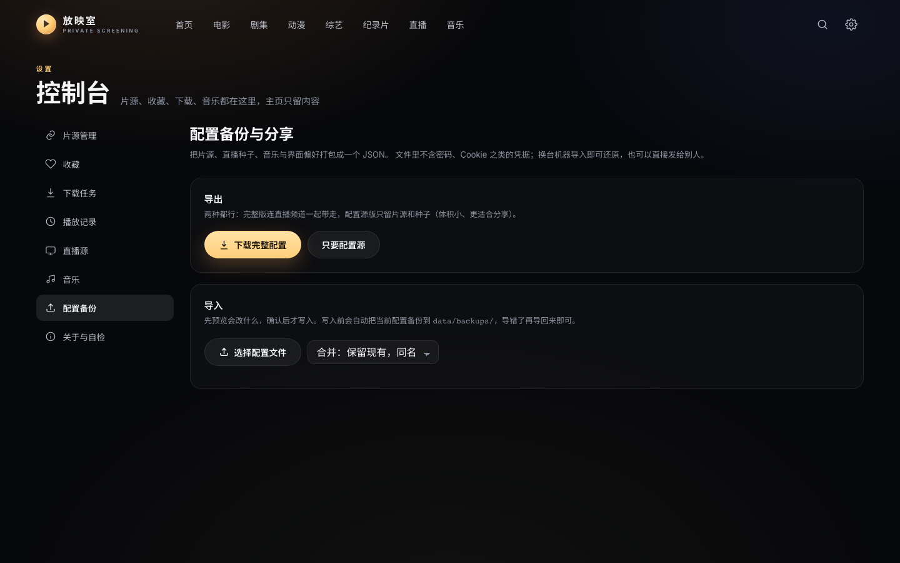

# 放映室 · Private Screening

**中文** · [English](README.en.md)

版本 **0.15.0** · Web / Android 手机 / Android TV 三端同源

> **空壳播放器。** 程序不含片源、频道、音乐接口与预置配置；仓库内没有媒体文件，也没有内容地址。
> 内容源由使用者自行提供，首次启动界面为空属预期。

## 目录

[1. 项目定位](#1-项目定位) · [2. 功能](#2-功能) · [3. 三端](#3-三端) · [4. 架构](#4-架构) ·
[5. 截图](#5-截图) · [6. 部署](#6-部署) · [7. 首次使用](#7-首次使用) · [8. 运行参数](#8-运行参数) ·
[9. 项目结构](#9-项目结构) · [10. 开发与测试](#10-开发与测试) · [11. 许可与声明](#11-许可与声明)

---

## 1. 项目定位

| 项 | 说明 |
|---|---|
| 是什么 | 影视 / 直播 / 音乐的统一播放前端，附配置分发与自升级后端 |
| 不是什么 | 不采集、不存储、不分发作品，不提供资源订阅 |
| 内容来源 | 使用者自备的采集站接口、直播列表、音乐服务 |
| 预置配置 | 无，零内置连接信息 |
| 账户 | 无登录、无 PIN |
| 运行方式 | 零构建，`python3 app.py` 即可，无需 pip / Node / 打包 |
| 离线 | NAS 关机后仍可搜索、浏览与播放 |
| 性质 | 个人自用，附带开源 |

---

## 2. 功能

### 2.1 影视

| 能力 | 说明 |
|---|---|
| 聚合搜索 | 并发查询全部片源，同名影片合并，列出全部线路 |
| 多线路播放 | 线路标注画质（4K / 1080P / 720P / HD），失败自动切换 |
| 剧集连载 | 按集排列；换线路保留进度；播完自动接续 |
| 片库浏览 | 电影 / 剧集 / 动漫 / 综艺 / 纪录片分栏，可按年份、地区、单源筛选 |
| 片源管理 | TVBox 配置地址批量导入、优先级排序、单源测试与启停（Web） |
| 下载 | 接入自建 qBittorrent；磁力结果带做种数，一键提交（Web） |

### 2.2 电视直播

| 能力 | 说明 |
|---|---|
| 导入与分组 | M3U / TXT 导入，自动分组，同名频道合并多线路 |
| 探活 | 一键检测；失效频道标记保留 |
| 每日汇总 | 每日抓取候选源，合并去重并探活，仅保留可播放频道 |
| 维护 | 分组查看、手动刷新、批量探活（Web） |

### 2.3 音乐

| 能力 | 说明 |
|---|---|
| 曲库 | 本地目录 ID3 / FLAC、Subsonic 兼容服务（Navidrome / Airsonic / Gonic）、在线歌单 |
| 发现 | 推荐与分类歌单、专辑墙、歌手、在线搜索 |
| 播放 | 队列、循环模式、滚动歌词、播放模式记忆 |
| 音效 | Web 为 10 段均衡器与 8 组预设；电视预设按设备频段适配 |
| 三端形态 | 手机为黑胶唱片与逐行歌词；电视为左唱片右歌词，方向键切歌 |

### 2.4 播放器

| 能力 | 说明 |
|---|---|
| 手势与遥控 | 单击暂停 / 播放，双击全屏；电视使用方向键、OK、BACK |
| 断点续播 | 进度按秒记录，下次从断点继续 |
| 缓冲态 | 模糊海报 + 跳动波点 + 实时速率 |
| 画中画 | 小窗播放时可继续浏览、搜索、换片 |
| 字幕 | App：内嵌字幕轨切换，支持本地 SRT / VTT / ASS / TTML，按「片名 + 集」记忆，四档字号；Web：仅外挂文件 |
| 音轨 | App：多音轨手动切换 |
| 跳过片头片尾 | 按剧记录区间；片头显示跳过按钮，片尾提示下一集与倒计时；仅本地记忆 |

### 2.5 投屏

手机发起，电视原位播放并向手机回报状态，不镜像画面。通道按可用性自动选择：

| 通道 | 接入方式 | 能力 |
|---|---|---|
| NAS 中转 | 两端连接同一台 NAS | 全功能：倍速、音量、进度回读；支持跨网段 |
| 局域网直投 | 同网段自动发现 | 全功能；不经 NAS |
| DLNA | 电视作为标准 DLNA 渲染器 | 播放 / 暂停 / 拖动 / 停止；不回读进度 |

局域网发现被拦截时可扫码配对（电视显示二维码与配对码）或手动输入地址。

### 2.6 管理

| 能力 | 说明 |
|---|---|
| 配置备份 | 导出完整配置或仅片源；导入前预览、写前备份、可回滚 |
| 配置分享 | 片源、直播源、音乐与界面偏好打包为单个 JSON |
| 配置分发 | NAS 下发配置包；App 启动时后台更新，内容未变不重绘 |
| 下载任务 | 暂停 / 继续 / 删除，状态自动刷新 |
| 自检 | 后端连通性、片源可用性、版本信息 |
| 内网自升级 | 启动时检查新版本，校验后拉起系统安装器 |

---

## 3. 三端

| | PC 浏览器 | 手机 App | 电视 App |
|---|---|---|---|
| 包名 | —（浏览器访问） | `com.projectionroom.app` | `com.projectionroom.tv` |
| 定位 | 管理台 + 消费端 | 随身消费端 | 大屏消费端 |
| 输入 | 键鼠 | 触摸 | 遥控器 |
| 浏览 / 搜索 / 播放 | ✅ | ✅ | ✅ |
| 收藏 / 播放记录 | ✅ | ✅ | ✅ |
| 音乐 | ✅ 完整 | ✅ 完整 | ✅ 完整（含音效预设） |
| 投屏 | 接收端控制 | ✅ 发射端 | 接收端 |
| 配置 | ✅ 全部入口 | 订阅源 + 导入导出 | 订阅源 + 导入导出 |
| 下载 / 定时备份 | ✅ | ❌ | ❌ |

手机为四个 tab（影视 / 直播 / 音乐 / 我的）；电视仅用 BACK 返回，页面不设可聚焦返回键，初始焦点落在首个可操作项。

---

## 4. 架构

Web 运行于 NAS，App 运行于设备；两者共享协议与配置，不共享运行时。

### 4.1 分层

```
PC 浏览器                手机 App                     电视 App
static/app/             ui-phone + app-phone         ui-tv + app-tv
零构建原生 ESM                │                            │
     │                   ┌────┴────────────────────────────┴────┐
     │                   │ ui-media  播放器 / 音乐 / 直播（共用） │
     │                   │ data      存储 / 同步 / 配对 / DLNA   │
     │                   │ core      纯 Kotlin：协议 / 合并 / 归一│
     │                   └─────────────────────────────────────┘
server/（Python 标准库，无框架、无 pip）
```

| 层 | 位置 | 职责 |
|---|---|---|
| 协议 | `native/core` | MacCMS 解析、跨源合并、片名归一、画质分档、投屏报文 |
| 平台 | `native/data` | 存储、配置包、NAS 闸门、收藏同步、局域网发现、DLNA |
| 视觉底座 | `native/ui-kit` | 主题、图标、骨架、背景 |
| 共用页面 | `native/ui-media` | 播放器、音乐库、直播库 |
| 端页面 | `ui-phone` / `ui-tv` | 手势交互 / 10-foot 焦点环 |
| Web | `static/app` + `server/` | 与 App 相同的 `/api/*` 语义 |

依赖方向单向：端页面 → 共用页面 → 视觉底座 → 平台层 → 协议层。

### 4.2 NAS 职责

| 职责 | 端点 |
|---|---|
| 同步 | `/api/fav` `/api/history` `/api/library` |
| 投射 | `/api/cast/*` |
| 更新 | `/api/app/latest` `/api/app/download` |
| 配置 | `/api/config/bundle` |

其余为资源加载（首页、片库、搜索、详情、线路、播放、封面、音乐），由客户端直连源站。
Web 端 HLS 经 `/api/proxy` 同源转发以绕过跨域限制。

### 4.3 本地数据

| 数据 | 主库 | 同步 |
|---|---|---|
| 片源 / 直播 / 音乐配置 | NAS | 比对版本号后重写 |
| 收藏 | 本地 | 写本地，后台推送 |
| 播放记录 | 本地 | 写本地，后台推送 |
| 首页推荐 | 本地聚合 | 快照 15 分钟后重算 |
| 投屏进度 | 电视 | 实时回报手机 |

配置与缓存均存本地，NAS 离线时首页、搜索与播放不受影响。

### 4.4 发现与配对

```
手机首次启动 ──► UDP 广播 PROOM_DISCOVER 至 8897 ──► NAS discovery_loop 返回 PROOM_OFFER
手机 ⇄ 电视 ──► 同网段 UDP 应答（局域网直投，不经 NAS）
                └─ 被拦截时：电视显示二维码与配对码，手机扫码直连
```

配对结果写入本地设置，后续不再依赖 NAS 在线。

---

## 5. 截图

截图仅展示界面结构与配置、配对流程，不含内容源数据与第三方作品信息。

配置备份与分享（导入前预览，写前自动备份）：



电视扫码配对（局域网自动发现被拦截时的直连方式）：

<p>

</p>

---

## 6. 部署

### 6.1 直接运行

```bash
git clone https://github.com/saury91/nas-screening.git
cd nas-screening
python3 app.py
```

打开 `http://127.0.0.1:8899`。首次启动自动建库，首页与五个分类的后台预热约需半分钟。

### 6.2 Docker

```bash
docker build -t projection-room .

docker run -d --name projection-room --restart unless-stopped --network host \
  -e DB_PATH=/data/media.db \
  -v /你的数据目录:/data \
  projection-room
```

接入 qBittorrent 与本地音乐目录：

```bash
docker run -d --name projection-room --restart unless-stopped --network host \
  -e DB_PATH=/data/media.db \
  -e QBT_URL=http://127.0.0.1:8080 \
  -e QBT_USER=<用户名> \
  -e QBT_PASS=<密码> \
  -e MUSIC_DIR=/music \
  -v /你的数据目录:/data \
  -v /你的音乐目录:/music:ro \
  projection-room
```

### 6.3 客户端构建

```bash
cd native
./gradlew :app-tv:assembleDebug      # 电视：native/app-tv/build/outputs/apk/debug/
./gradlew :app-phone:assembleDebug   # 手机：native/app-phone/build/outputs/apk/debug/
adb install -r <apk 路径>
```

JDK 17、compileSdk 35。APK 使用仓库内固定密钥签名（`native/keystore/proom.jks`，密码 `proom-release`），任意构建产物可相互覆盖升级；该密钥为公开信息，不提供安全强度。需要独立签名时使用 `PROOM_KEYSTORE`、`PROOM_KEYSTORE_PASS` 替换。

TV 首次安装需允许「安装未知应用」。

---

## 7. 首次使用

> 8899 默认无鉴权，仅适用于内网，不应直接暴露到公网。需要外网访问时，请在前置反向代理上添加鉴权。

安装包不含任何内容源，首次打开显示「还没有片源」属预期。配置顺序：

1. **导入片源**：控制台 → 片源管理，粘贴 TVBox 配置地址批量导入。
2. **导入直播**：控制台 → 直播源，填写候选源地址，之后每日自动抓取、合并、探活。
3. **接入音乐**（可选）：本地目录或 Navidrome / Airsonic / Gonic；在线歌单与搜索需自备接口。

导入自备数据有三种方式：

| 方式 | 做法 | 适用场景 |
|---|---|---|
| 配置包 | 控制台 → 配置备份 → 导入 JSON | 从另一台机器迁移 |
| 手动填写 | 片源管理逐条添加，或粘贴 TVBox 配置地址 | 少量添加 |
| seed 文件 | 将导出的 `seed.json` 放到 `data/seed.json` 后启动 | 一次导入整套 |

```bash
# 从当前库导出
python3 tools/export-seed.py                 # → data/seed.json

# 启动时导入
DB_PATH=/data/media.db SEED_FILE=/data/seed.json python3 app.py
```

---

## 8. 运行参数

| 变量 | 默认值 | 说明 |
|---|---|---|
| `PORT` | `8899` | 监听端口 |
| `DB_PATH` | `./data/media.db` | 数据文件位置，容器内建议指向挂载卷 |
| `SEED_FILE` | `./data/seed.json` | 启动时导入的数据文件；不存在则空启动 |
| `LIVE_SEEDS` | 空 | 直播候选源，逗号分隔，用于每日汇总 |
| `CMS_SEEDS` | 空 | 片源「资源目录」地址，逗号分隔，用于自动发现 |
| `MUSIC_ONLINE` | `0` | 为 `1` 时启用在线搜歌 |
| `ONLINE_SEARCH_URL` | 空 | 在线搜歌接口，空即关闭 |
| `ONLINE_PLAY_URL` | 空 | 播放地址转换接口，空则不返回在线播放地址 |
| `ONLINE_COVER_BASE` | 空 | 在线封面图前缀 |
| `ONLINE_REFERER` | 空 | 上述接口要求的 Referer |
| `MUSICBOX_API` | 空 | 在线歌单 / 播放接口，空即关闭在线音乐 |
| `MUSICBOX_REFERER` | 空 | 在线歌单接口要求的 Referer |
| `LYRIC_API` | 空 | 歌词接口，随配置包下发给 App |
| `LYRIC_REFERER` | 空 | 歌词接口要求的 Referer |
| `MAGNET_SITE` | 空 | 磁力搜索站地址，空即关闭磁力搜索 |
| `MUSIC_DIR` | 空 | 本地音乐目录，也可在设置页填写 |
| `QBT_URL` | `http://127.0.0.1:8080` | qBittorrent 地址 |
| `QBT_USER` / `QBT_PASS` | 空 | 仅通过环境变量传入，无默认凭据 |
| `NO_AUTH` | `1` | 为 `0` 时启用多账户 |
| `PROXY_ALLOW_PRIVATE` | 空 | HLS 代理默认拒绝私网地址；确有内网源时设为 `1` 放开 |

以上变量也可写入仓库根目录的 `.env`，`app.py` 启动时自动读取（不覆盖已存在的环境变量）。

---

## 9. 项目结构

```
nas-screening/
├── app.py                      后端入口（Python 标准库，无框架）
├── server/                     后端模块
│   ├── api/                    路由：proxy / source / fav / history / cast …
│   ├── sources.py              片源：配置解析 / 搜索 / 详情 / 线路（带缓存）
│   ├── live_sources.py         直播：导入 / 探活 / 每日汇总
│   ├── music*.py               音乐：本地 / Subsonic / 在线
│   ├── db.py                   存储层
│   └── app_upgrade.py          APK 版本检查与分发
├── static/
│   ├── app/                    Web 控制台（零构建原生 ESM）
│   ├── styles/  theme.js       样式与主题
│   └── vendors/                本地化的第三方库
├── native/                     Android（Kotlin Multiplatform）
│   ├── core/                   协议 / 合并 / 归一（纯 Kotlin）
│   ├── data/                   存储 / 同步 / 配对 / DLNA
│   ├── ui-kit/  ui-media/      视觉底座与共用页面
│   ├── app-phone/  app-tv/     手机端与电视端
├── docs/                       截图
├── tools/                      发布与导入辅助脚本
└── tests/                      Python 单测
```

---

## 10. 开发与测试

```bash
python3 -m unittest discover -s tests            # Python
cd native && ./gradlew :core:testDebugUnitTest   # Kotlin（协议层覆盖最全）

./scripts/publish-apk.sh                         # 编译并写入 APK 版本信息
```

`publish-apk.sh` 将 APK 与 `{versionCode, versionName, size, sha256, notes}` 写入 `data/apps/`；App 校验大小与 sha256 后才进入安装器。

推送 `v*` 标签时，GitHub Actions 自动跑两端测试并编译三套产物。

---

## 11. 许可与声明

代码以 [MIT 许可证](LICENSE) 发布，按原样提供，不附带任何明示或默示担保。

本项目不提供、不存储、不分发任何影视或音乐内容。作品著作权归各自权利人所有；接入哪些源、播放什么、从何处播放，由使用者自行决定并自行承担全部责任。项目不推荐、不背书、不维护任何第三方源，不对其合法性、可用性与内容作任何判断或保证。

使用本项目造成的任何直接或间接损失，作者不承担责任；下载、部署或使用即视为接受本声明。文中出现的第三方名称、商标归各自所有者，仅用于说明兼容性。
