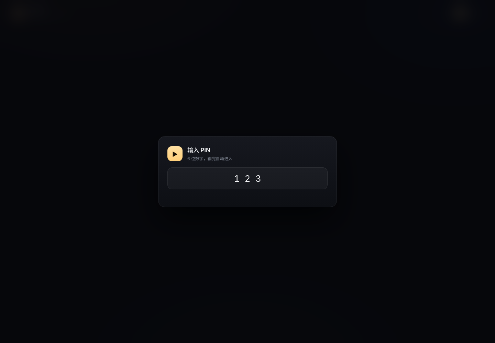
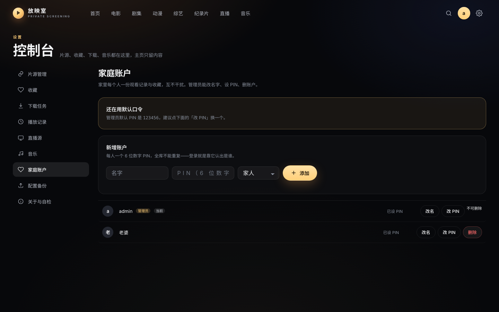
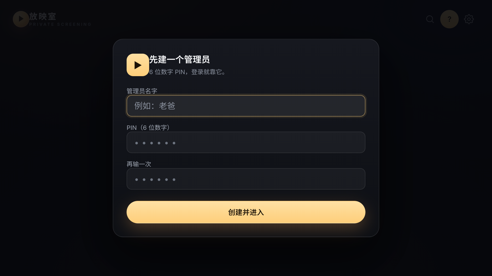
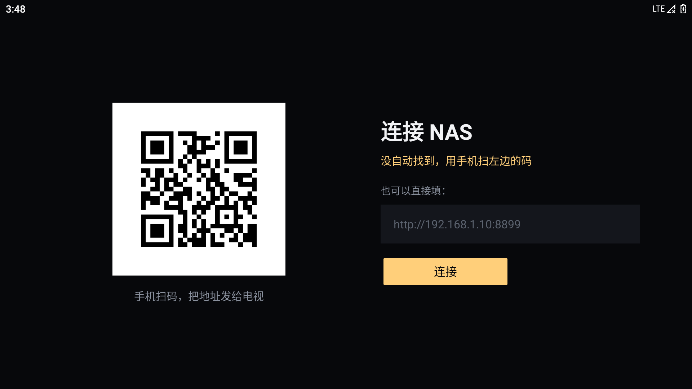

# 放映室 · NAS 个人娱乐中心

把**影视、电视直播、音乐**收进一个网页，跑在你自己的 NAS 上；同一个界面也能装到电视上。

搜片名 → 点开 → 直接播。片源、直播、下载任务都在设置里管理，主页只留内容。

| 能力 | 状态 |
|---|---|
| 影视聚合 · 多片源合并 · 断点续播 | ✅ |
| 电视直播 · 每日自动汇总探活 | ✅ |
| 音乐 · 本地/Subsonic · 在线歌单 · 歌词 | ✅ |
| 家庭账户 · 每人一份记录与收藏 | ✅ |
| 配置导出/导入（可分享、跨版本） | ✅ |
| Android TV 端（侧载 · 自动发现 · 内网自升级） | ✅ 0.2.0 |
| 手机端 App · 投屏到电视 | 🚧 下一步 |

网页、电视盒子用的是同一套界面：**UI 只有一份**，App 只是把网页装进壳里，再加原生播放器。

> ## ⚠️ 使用前必读
>
> **本项目不提供、不存储、不托管、不转录、不分发任何音视频内容。**
> 它只是一个界面：所有影片、频道、播放地址都来自第三方公开接口，本项目只负责展示和转发。
> 请仅在你拥有合法访问权的设备与网络中使用，并自行承担全部责任。
> **严禁用于商业用途、公开传播或任何形式的收费服务。** 完整条款见文末。

---

## 首页

打开就是你最近在看的东西，和几排按口味挑的片子。


- 顶部是当日推荐，可以直接开播，也可以翻页看看别的
- 「继续观看」接着上次的位置往下看
- 片库按电影、剧集、动漫、综艺、纪录片分开，横向滑动浏览

---

## 影视

一次搜索同时问所有片源，同一部片自动合并，列出全部线路。


- 片库支持按**年份、地区、单个片源**筛选
- 详情页能看到简介、导演、主演、评分，以及每条线路的画质（4K / 1080P / 720P）
- 剧集按集排列，换线路不会丢进度
- 播放进度每几秒记一次，下次从停下的地方继续；一集播完自动接下一集
- 某条线路播不动，会自己换下一条

---

## 播放器


- **单击画面暂停/播放，双击全屏**；手机上也是同一套手势
- 遥控器方向键移动焦点、回车确认、Esc 返回，电视上不用鼠标
- 缓冲时画面是这张片子的模糊海报 + 三个跳动的波点 + 实时网速，不转圈
- 支持画中画：开了小窗可以继续浏览、搜索、换片，关掉小窗即结束

---

## 电视直播


- 导入 M3U / TXT 直播源，自动按分组归类，同名频道合并多线路
- 一键**检测可用**，能播的排前面，失效的压暗但保留
- **每天自动汇总**：把你配置的候选源全部拉一遍 → 合并去重 → 逐条探活 → 只留下能播的频道
- 分组切换、频道搜索、手动刷新

---

## 音乐


- 两种来源任选：**本地目录**（直接读 NAS 上的 ID3 / FLAC 标签与封面）或 **Subsonic 兼容服务**（Navidrome / Airsonic / Gonic）
- 不配置也能听：**推荐歌单**以封面卡铺开，**分类歌单**按主题 / 语种 / 风格 / 场景 / 情感翻
- 点开歌单是独立详情页：封面、简介、完整曲目，一键「播放全部」
- 专辑墙、歌手、专辑详情、播放队列，外加在线搜歌


- **播放列表详情**：点任意一首都从这个位置往后接着放
- **滚动歌词**：逐行高亮居中，点某一行直接跳到那句；没有歌词就老实说没有
- **转动的唱片**：封面做成黑胶，播的时候转，暂停就停
- **拖动进度**：点一下跳过去，按住可以拖；当前时间 / 总时长都在
- **播放时的粒子**：进度条随播放飘出音符与星光（canvas 绘制，暂停即停，`prefers-reduced-motion` 下自动关闭）
- **播放模式**：顺序、单曲循环、随机，选了会记住
- **播放列表**：右侧抽屉里看全部曲目，点哪首放哪首，也能从列表里删掉
- **收藏**：点心心存入本机数据库，音乐页多出「我的收藏」货架
- **音效**：10 段均衡器 + 8 组预设（流行 / 摇滚 / 爵士 / 古典 / 人声 / 低音 / 夜听），浏览器原生 Web Audio 实现，不引入任何第三方库
- 底部迷你播放器，点开是全屏 Now Playing

---

## 下载（可选）

- 接自己的 qBittorrent，磁力搜索结果带做种数，一键提交
- 任务列表在设置里，可暂停 / 继续 / 删除，状态自动刷新

---

## 家庭账户



内网自用，所以只做「一个管理员 + 几个家人」，不搞注册、找回密码那一套——**登录只要一个 PIN**。

- **开箱即用**：首次启动自动建好管理员 **`admin` / `123456`**，打开网页直接输 PIN 就能进
- **PIN 就是身份**：不选账户，输 6 位数字自动匹配到人（输满 6 位自动进入，电视遥控器也顺手）
- **PIN 全库唯一**：每人的 PIN 6 位纯数字且不重复，重复时直接告诉你是谁的 PIN 占了
- 老数据自动归到管理员名下，不丢记录；默认 PIN 没改的话，设置页会提醒你换掉
- **管理员账户不可删除**（家人账户可以删，删了连同其记录一并清掉）
- **每个人一份**观看记录与收藏，互不覆盖；右上角头像切换账户，有 PIN 的输一次即可
- **管理员**能改片源、直播源、导入导出配置、管其它账户；家人看不到这些页面（后端也会再挡一层）
- 连续输错 8 次会锁 5 分钟，避免内网里有人慢慢试
- 会话存库、默认 30 天免登录；PIN 用 PBKDF2 存哈希，不存明文

忘 PIN 了？在 NAS 上跑命令行救急（不依赖网页）：

```bash
python3 tools/account.py list              # 看有哪些账户
python3 tools/account.py reset 老爸 123789  # 重置 PIN（6 位数字）
python3 tools/account.py kick              # 踢掉所有已登录设备
```



> 这是**内网**方案：没有密码、没有找回、没有 HTTPS。如果哪天要暴露到公网，
> 前面必须加一层真正的鉴权（反向代理的 Basic Auth 或独立网关），别直接开门。

---

## 电视 / 手机 App（Android）



Android TV 端已经能日常用了（0.2.0）：一个全屏 WebView 装现有前端，播放交给原生 ExoPlayer。
**电视上没有"注册/建管理员"**——初始化是 NAS 上一次性的事，电视只输 PIN。



- **侧载安装**：从 CI 产物或 Release 拿 APK，U 盘拷到电视，或用 `adb install`。不上任何应用商店
- **地址不用手输**（三条路，按遥控器友好度排序）：
  1. **自动发现**：电视广播一句、NAS 应答，同网段 1 秒内配好，全程不用按键
  2. **手机扫码**：电视显示二维码，手机打开后填一次地址发过来
  3. 手动输入（留给调试）
- **之后只输 PIN**：6 位数字，输满自动进入；按遥控器「菜单」键可重设地址
- **遥控器**：方向键移动焦点、OK 确认、返回键回上一页，焦点环和电脑端一致
- **每次冷启动要重输 PIN**：TV 端不持久化会话，切后台回来不用重输
- **原生播放**：HLS 走 ExoPlayer 硬解，不在 WebView 里软解（老电视软解 4K 会卡死）
- **内核自检**：WebView 低于 55 直接给出说明页，不会白屏

最低 Android 5.0（API 21），编译目标 34。

> 如果 NAS 开了防火墙，记得放行 **UDP 8897**（自动发现）和 **TCP 8898**（扫码配对），
> 否则电视只能用第三条路手动填地址。

手机端：同一套前端，下一步做设备自适应（竖屏、会话 30 天）和投屏，目前请直接用手机浏览器打开。

### 签名与内网自升级

APK 用固定密钥签名（`android/keystore/proom.jks`，密码 `proom-release`），
**签名必须一致才能覆盖安装**，所以这份密钥跟着仓库走，保证谁构建都是同一条升级链。

> 它只保证升级不被"签名不一致"挡住，不提供安全强度：密钥是公开的。
> 想更稳妥就在 CI/本地用 `PROOM_KEYSTORE`、`PROOM_KEYSTORE_PASS` 换成你自己的。

发布新版本：

```bash
cd android && gradle assembleRelease        # 产物 5.3MB，比 debug 小
cd .. && ./tools/publish-apk.sh             # 拷到 data/apps/ 并写版本信息
```

App 启动时会问一句 `GET /api/app/latest?kind=tv`，比本地 `versionCode` 新就弹窗，
点「更新」从 NAS 下载并交给系统安装器。电视第一次装需要允许「安装未知应用」。

本地构建（JDK 17 + Android SDK 34 + Gradle 8.7）：

```bash
cd android && gradle assembleDebug
```

推送到 `main` 会自动编译并上传 APK 产物；打 `tv-v*` 标签会自动发 Release。

---

## 配置备份与分享


片源、直播种子、音乐与界面偏好可以打包成一个 JSON，在 **设置 → 配置备份** 里导出 / 导入（仅管理员）。

- **仓库里只有代码**：`data/` 与 `*.db` 都在 `.gitignore` 里，配置不会跟着提交
- **可以分享**：把 JSON 发给别人，对方导入即用；不带密码、Cookie 等凭据
- **导入有预览**：先看会新增/更新多少条、哪些条目被跳过，确认后才写入
- **导错了能回滚**：写入前自动把当前配置备份到 `data/backups/`
- **跨版本可读**：带 `schema` 版本号与迁移表，老配置自动升级，更新的配置会被明确拒绝而不是写坏数据

格式与迁移规则见 [`docs/config-schema.md`](docs/config-schema.md)。

---

## 开始使用

### 直接运行

```bash
git clone https://github.com/saury91/nas-screening.git
cd nas-screening
python3 app.py
```

打开 `http://127.0.0.1:8899`。第一次启动会自动建库，首页推荐需要十几秒预热。

> 不需要 pip，也不需要装 Node、跑打包。

### Docker

```bash
docker build -t projection-room .

docker run -d --name projection-room --restart unless-stopped --network host \
  -e DB_PATH=/data/media.db \
  -v /你的数据目录:/data \
  projection-room
```

接 qBittorrent 和本地音乐目录：

```bash
docker run -d --name projection-room --restart unless-stopped --network host \
  -e DB_PATH=/data/media.db \
  -e QBT_URL=http://127.0.0.1:8080 \
  -e QBT_USER=<用户名> \
  -e QBT_PASS=<密码> \
  -e MUSIC_DIR=/music \
  -v /你的数据目录:/data \
  -v /你的音乐目录:/music:ro \
  projection-room
```

### 第一次打开，建议做四件事

1. **改掉默认 PIN**：设置 → 家庭账户 → 改 PIN。默认是 `admin / 123456`，全家都靠它认人。
2. **加片源**：设置 → 片源管理。粘贴一个 TVBox 配置地址批量导入，或者点「自动发现片源」让它自己去找。
3. **加直播**：设置 → 直播源。填几个候选源地址，之后每天会自动帮你重新抓取和筛选。
4. **接音乐**（可选）：不接也能听在线歌单；想听自己的歌，再填 NAS 音乐目录或 Navidrome 地址。

> 想让电视也能用？见上面的「电视 / 手机 App」，装个 APK 就行。

---

## 运行参数

| 变量 | 默认值 | 说明 |
|---|---|---|
| `PORT` | `8899` | 监听端口 |
| `DB_PATH` | `./data/media.db` | 数据文件位置，容器里建议指向挂载卷 |
| `MUSIC_DIR` | 空 | 本地音乐目录，也可以之后在设置页里填 |
| `QBT_URL` | `http://127.0.0.1:8080` | qBittorrent 地址 |
| `QBT_USER` / `QBT_PASS` | 空 | 只通过环境变量传入，代码里没有默认凭据 |

---

## 界面

- 暗色影院风格，暖金色作为唯一强调色
- 遥控器、键盘、鼠标、触屏都能用
- 宽屏有版心，不会把内容拉得又扁又长
- 字体自托管，不依赖任何 CDN

---

## 项目结构

```
app.py                  启动入口：建库、预热、UDP 发现应答
server/
  api.py                路由 + 鉴权守卫（只做参数解析与序列化）
  db.py                 SQLite 建表与迁移（含 profile 维度）
  services/
    auth.py             家庭账户：PIN 哈希、会话、节流
    config_io.py        配置包导出/导入（schema 版本 + 迁移）
    musicbox.py         在线歌单（推荐、分类、歌单详情）
    proxy.py            HLS 同源代理（含私网防护）
static/
  app/                  零构建前端：原生 ES Modules + 手写 CSS
  index.html            单页入口
android/                Android TV 壳（Kotlin + ExoPlayer + ZXing）
  keystore/             发布密钥（固定签名，见上文说明）
tools/                  account.py 救急命令、publish-apk.sh 发版、cdp.js 截图自检
tests/                  纯函数单测（不依赖网络与真实数据库）
docs/                   截图、配置包格式说明、审计记录
```

## 测试

```bash
python3 -m unittest discover -s tests -v     # 40 条纯函数单测
cd android && gradle assembleRelease         # 编译即校验
```

CI（`.github/workflows/ci.yml`）会跑 Python 编译 + 单测 + 前端 ESM 语法检查；
`android.yml` 负责出 APK。

---

## 免责声明

**请在使用前完整阅读。开始使用即视为你已阅读、理解并同意以下全部内容。**

1. **本项目不提供任何内容。** 不存储、不托管、不转录、不分发、不销售任何影视、直播、音乐作品；仓库中不含任何音视频文件，也不含任何播放地址清单。

2. **内容全部来自第三方。** 搜索、详情、播放地址均由第三方公开接口返回，本项目仅做协议解析、界面展示与同源转发。第三方接口的内容、合法性、准确性、可用性，本项目无法控制也不作任何保证。

3. **与任何内容方无关。** 本项目与任何影视平台、电视台、版权方、采集站均无关联、无合作、无授权关系，也未获得任何内容授权。

4. **使用者自负全部责任。** 你需自行确认所在国家或地区的法律法规，并对自己安装、配置、访问、播放、下载的一切行为及其后果承担全部责任。因使用本项目引起的任何法律纠纷、版权索赔、行政处罚、数据丢失或设备损坏，作者与贡献者不承担任何责任。

5. **禁止商业与公开使用。** 严禁将本项目用于商业用途、收费服务、公开传播、二次分发，或部署为面向公众的公开站点。

6. **侵权处理方式。** 本项目不持有任何内容，无法删除第三方站点上的内容。若你认为某项内容侵权，请直接向该内容所在的站点主张权利；本项目不参与、也无法代为处理。

7. **不提供技术支持与可用性承诺。** 项目按「现状」提供，不保证任何接口长期可用、不保证播放质量、不保证与你的设备兼容。

8. **不同意请立即停止使用**，并删除本项目及其产生的全部数据。

---

## 许可

代码以仓库内的 LICENSE 为准。界面使用的 Inter / Noto Sans SC 字体均为 SIL Open Font License 1.1，授权与来源见 `static/fonts/README.md`。
