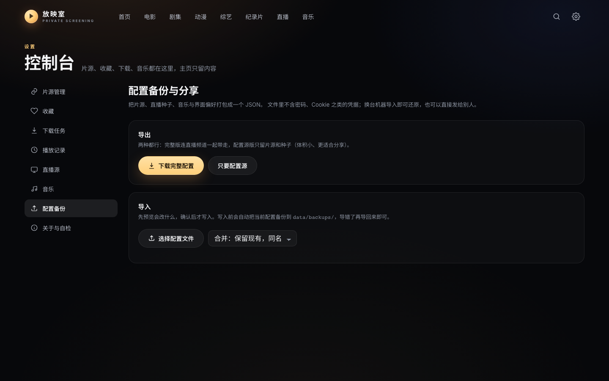

# 放映室 · Private Screening

**中文** · [English](README.en.md)

版本 **0.15.0** · Web / Android 手机 / Android TV 三端同源

> **空壳播放器。** 程序不含任何片源、频道、音乐接口与预置配置；仓库内没有媒体文件，也没有任何内容地址。
> 首次启动看到空白界面是设计结果，不是故障。所有内容源由使用者自行寻找、自行配置。

---

## 目录

- [1. 项目定位](#1-项目定位)
- [2. 功能清单](#2-功能清单)
  - [2.1 影视](#21-影视)
  - [2.2 电视直播](#22-电视直播)
  - [2.3 音乐](#23-音乐)
  - [2.4 播放器](#24-播放器)
  - [2.5 投屏](#25-投屏)
  - [2.6 管理与备份](#26-管理与备份)
  - [2.7 独立运行](#27-独立运行)
- [3. 三端能力矩阵](#3-三端能力矩阵)
- [4. 界面截图](#4-界面截图)
- [5. 部署](#5-部署)
- [6. 首次使用](#6-首次使用)
- [7. 运行参数](#7-运行参数)
- [8. 项目结构](#8-项目结构)
- [9. 开发与测试](#9-开发与测试)
- [10. 许可与内容声明](#10-许可与内容声明)

---

## 1. 项目定位

| 项 | 说明 |
|---|---|
| 是什么 | 影视 / 直播 / 音乐的统一播放前端，外加一个只负责配置分发与自升级的轻后端 |
| 不是什么 | 不是内容站：不采集、不存储、不分发任何作品，不提供任何资源订阅 |
| 内容来源 | 使用者自行提供的采集站接口、直播列表、音乐服务 |
| 预置配置 | 无。配置包为空壳，连接信息零内置 |
| 开源性质 | 作者自用项目顺手开源，非商业项目，无运营、无技术支持承诺 |
| 运行方式 | 零构建前端，`python3 app.py` 即开即用，不需要 pip / Node / 打包 |
| 离线能力 | NAS 关机后，客户端仍可搜索、看详情、播放，配置停在最后一次同步的版本 |

---

## 2. 功能清单

### 2.1 影视

| 能力 | 说明 |
|---|---|
| 聚合搜索 | 一次同时问全部片源，同一部片自动合并，列出全部线路 |
| 多线路播放 | 每条线路标出画质（4K / 1080P / 720P / HD），播不动自动换下一条 |
| 剧集连载 | 按集排列，换线路不丢进度，一集播完自动接下一集 |
| 片库浏览 | 电影 / 剧集 / 动漫 / 综艺 / 纪录片分栏，按年份、地区、单源筛选 |
| 片源管理 | TVBox 配置地址一键导入、优先级排序、单个测试、开关（Web） |
| 下载 | 接自己的 qBittorrent，磁力搜索结果带做种数，一键提交（Web） |

### 2.2 电视直播

| 能力 | 说明 |
|---|---|
| 导入与分组 | M3U / TXT 导入，自动分组，同名频道合并多线路 |
| 探活 | 一键检测，失效频道标记保留、不自动删除 |
| 每日汇总 | 每日自动抓取候选源，合并去重并探活，只保留可播放频道 |
| 维护 | 分组查看、手动刷新、批量探活（Web） |

### 2.3 音乐

| 能力 | 说明 |
|---|---|
| 曲库 | 本地目录 ID3 / FLAC、Subsonic 兼容服务（Navidrome / Airsonic / Gonic）、在线歌单 |
| 发现 | 推荐歌单、分类歌单（主题 · 语种 · 风格 · 场景 · 情感）、专辑墙、歌手、在线搜歌 |
| 播放 | 队列、循环模式、滚动歌词、粒子进度条、播放模式记忆 |
| 音效 | Web 为 10 段均衡器 + 8 组预设；电视的音效预设按设备频段自动适配 |
| 三端形态 | 手机为黑胶唱片 + 逐行歌词、播放条常驻；电视为左唱片右歌词，遥控器上下切歌、左右调进度 |

### 2.4 播放器

| 能力 | 说明 |
|---|---|
| 手势与遥控器 | 单击暂停 / 播放，双击全屏；电视用方向键移动焦点、回车确认、BACK 返回 |
| 断点续播 | 进度每几秒记一次，下次从停下的地方继续 |
| 缓冲态 | 模糊海报 + 三个跳动波点 + 实时网速，不转圈 |
| 画中画 | 开小窗可继续浏览、搜索、换片，关窗即结束 |
| 字幕 | App 端：内嵌字幕轨可开关切换，本地 SRT / VTT / ASS / TTML 可直接挂；按「片名 + 集」记住，重进同一集自动带出；字号四档。Web 控制台：本地 SRT / VTT / ASS 可选、字号四档，不解析流内嵌字幕轨 |
| 音轨 | App 端：多音轨（双语解说、国配/原声）可手动切换，默认交回系统自动选择 |
| 跳过片头片尾 | 按剧记住时长，播放到片头区间时浮出「跳过片头」（点了才跳，不自动切正片）：手机是右下角药丸，电视是底栏里能落焦的按钮（药丸不是焦点目标，遥控器落不上去）；片尾区间提示「下一集」并带倒计时，可逐个取消。直播不参与，纯本地记忆，NAS 关机不影响 |

### 2.5 投屏

手机发起投屏，电视原地播放，手机随即变成遥控器。电视为接收端，进度真实回报，不镜像手机画面。
通道不支持的操作置灰，连接方式按可用性自动选择：

| 通道 | 接入方式 | 能力 |
|---|---|---|
| NAS 中转 | 两端连接同一台 NAS | 全部功能：倍速、音量、进度回读；跨网段可用 |
| 局域网直投 | 同一局域网自动发现 | 全部功能；不经过 NAS，NAS 关机也能用 |
| DLNA | 电视作为标准 DLNA 接收端 | 仅播放 / 暂停 / 拖动 / 停止，不回报进度 |

局域网自动发现被路由拦截时，可扫码直连（电视显示二维码与配对码）或手动填写地址。

### 2.6 管理与备份

| 能力 | 说明 |
|---|---|
| 配置备份 | 导出完整配置或只要片源；导入有预览，写前自动备份，可回滚 |
| 配置分享 | 片源、直播源、音乐与界面偏好打包成一个 JSON，可导出导入 |
| 配置分发 | NAS 只发配置包，App 启动后台静默更新，内容没变就不重绘 |
| 下载任务 | 暂停 / 继续 / 删除，状态自动刷新 |
| 关于与自检 | 后端连通性、片源可用性、版本信息一览 |
| 内网自升级 | App 启动时检查新版本，提示并拉起系统安装器 |

### 2.7 独立运行

| 能力 | 说明 |
|---|---|
| App 独立运行 | NAS 关机也能搜、看、播，配置停在最后一次同步的版本 |
| 无账户 | 打开即用，没有登录、没有 PIN（`NO_AUTH=1` 默认） |
| 本地缓存 | 页面数据与影片索引存本地，先渲染再拉新，界面不跳 |
| 零第三方依赖 | 前端零构建、字体自托管、不引用任何 CDN |

### 2.8 接口边界

NAS 只承担四类接口：同步（收藏 / 记录 / 片库）、投射（投屏桥接）、更新（版本检查与 APK 下载）、配置（配置包与配置内含的频道表）。
其余全部为资源加载，由客户端直连源站，不经 NAS 中转。

---

## 3. 三端能力矩阵

| | PC 浏览器 | 手机 App | 电视 App |
|---|---|---|---|
| 包名 | —（浏览器直接访问） | `com.projectionroom.app` | `com.projectionroom.tv` |
| 定位 | 管理台 + 消费端 | 随身消费端 | 大屏消费端 |
| 输入 | 键鼠 | 触摸 | 遥控器 |
| 浏览 / 搜索 / 播放 | ✅ | ✅ | ✅ |
| 收藏 / 播放记录 | ✅ | ✅ | ✅ |
| 音乐 | ✅ 完整 | ✅ 完整 | ✅ 完整（含音效预设） |
| 投屏 | 接收端控制 | ✅ 发射端 | 接收端 |
| 片源 / 直播源 | ✅ 全部入口 | ✅ 订阅源 + 配置导入导出 | ✅ 订阅源 + 配置导入导出 |
| 下载 / 定时备份 | ✅ 全部入口 | ❌ 不提供 | ❌ 不提供 |

| 端 | 约束 |
|---|---|
| PC | 打开 `http://<nas>:8899` 即最新版；自适应版心覆盖 375–3840 |
| 手机 | 四个 tab：影视 / 直播 / 音乐 / 我的；配置能力限于订阅源与配置导入导出，片源探测、下载、定时备份仍只在 PC 控制台 |
| 电视 | 只用遥控器 BACK 返回，页面不设可聚焦返回键；初始焦点落在首个可操作项；不提供锁屏、画中画、投屏入口；没有系统文件选择器，本地字幕需在手机上选好 |

---

## 4. 界面截图

以下截图仅展示界面结构与配置、配对流程，不含任何内容源数据，也不展示任何第三方作品信息。

配置备份与分享（导入前先预览，写前自动备份）：



电视扫码配对（局域网自动发现被拦截时的直连方式）：

<p>

</p>

---

## 5. 部署

### 5.1 直接运行

```bash
git clone https://github.com/saury91/nas-screening.git
cd nas-screening
python3 app.py
```

打开 `http://127.0.0.1:8899`。首次启动自动建库，首页推荐需十几秒预热。

### 5.2 Docker

```bash
docker build -t projection-room .

docker run -d --name projection-room --restart unless-stopped --network host \
  -e DB_PATH=/data/media.db \
  -v /你的数据目录:/data \
  projection-room
```

接 qBittorrent 与本地音乐目录：

```bash
docker run -d --name projection-room --restart unless-stopped --network host \
  -e DB_PATH=/data/media.db \
  -e QBT_URL=http://127.0.0.1:8080 \
  -e QBT_USER=<用户名> \
  -e QBT_PASS=<密码> \
  -e MUSIC_DIR=/music \
  -v /你的数据目录:/data \
  -v /你的音乐目录:/music:ro \
  projection-room
```

### 5.3 客户端构建

```bash
cd native
./gradlew :app-tv:assembleDebug      # 电视：native/app-tv/build/outputs/apk/debug/
./gradlew :app-phone:assembleDebug   # 手机：native/app-phone/build/outputs/apk/debug/
adb install -r <apk 路径>
```

JDK 17、compileSdk 35。APK 使用仓库内固定密钥签名（`native/keystore/proom.jks`，密码 `proom-release`），
保证任意构建产物可相互覆盖升级；该密钥为公开信息，不提供安全强度。需要独立签名时用
`PROOM_KEYSTORE`、`PROOM_KEYSTORE_PASS` 替换。

TV 首次安装需允许「安装未知应用」；国产 ROM 会弹「未备案 / 风险应用」提示，勾选「已了解风险」继续即可。

---

## 6. 首次使用

安装包不含任何内容源：没有片源、没有频道、没有音乐接口。首次打开显示「还没有片源」属正常现象。

配置顺序：

1. **不要把 8899 直接暴露到公网**：默认无鉴权，只应是内网服务；要外网访问请加反向代理鉴权。
2. **导入片源**：控制台 → 片源管理，粘贴 TVBox 配置地址批量导入。
3. **导入直播**：控制台 → 直播源，填候选源地址，之后每日自动抓取、合并、探活。
4. **接音乐**（可选）：本地目录或 Navidrome / Airsonic / Gonic；在线歌单与在线搜歌需自填接口。

仓库里没有任何采集站地址、直播列表、音乐接口。把自备数据装进来有三种方式：

| 方式 | 做法 | 适用 |
|---|---|---|
| 配置包 | 控制台 → 配置备份 → 导入，选一个 JSON | 从别的机器搬过来 |
| 手动填 | 片源管理里逐条添加，或粘 TVBox 配置地址 | 只加几个 |
| seed 文件 | 把导出的 `seed.json` 放到 `data/seed.json` 再启动 | 一次装好整套 |

`seed.json` 与配置包是同一份格式：

```bash
# 从当前库导出（内含真实地址，只留在本地）
python3 tools/export-seed.py                 # → data/seed.json

# 换台机器：文件放到同一路径，启动即导入
DB_PATH=/data/media.db SEED_FILE=/data/seed.json python3 app.py
```

---

## 7. 运行参数

| 变量 | 默认值 | 说明 |
|---|---|---|
| `PORT` | `8899` | 监听端口 |
| `DB_PATH` | `./data/media.db` | 数据文件位置，容器内建议指向挂载卷 |
| `SEED_FILE` | `./data/seed.json` | 启动时导入的数据文件；不存在则空启动 |
| `LIVE_SEEDS` | 空 | 直播候选源，逗号分隔，每日汇总用 |
| `CMS_SEEDS` | 空 | 片源「资源目录」地址，逗号分隔，自动发现用 |
| `MUSIC_ONLINE` | `0` | 为 `1` 时启用在线搜歌 |
| `ONLINE_SEARCH_URL` | 空 | 在线搜歌接口，空即关闭；需与 `MUSIC_ONLINE=1` 同时满足 |
| `ONLINE_PLAY_URL` | 空 | 播放地址转换接口，空即不返回在线播放地址 |
| `ONLINE_COVER_BASE` | 空 | 在线封面图前缀，空则搜索结果不带封面 |
| `ONLINE_REFERER` | 空 | 上述接口要求的 Referer |
| `MUSICBOX_API` | 空 | 在线歌单 / 播放接口地址，空即关闭在线音乐 |
| `MUSICBOX_REFERER` | 空 | 在线歌单接口要求的 Referer |
| `LYRIC_API` | 空 | 歌词接口，随配置包下发给 App；空则显示「暂无歌词」 |
| `LYRIC_REFERER` | 空 | 歌词接口要求的 Referer |
| `MAGNET_SITE` | 空 | 磁力搜索站地址，空即关闭磁力搜索 |
| `MUSIC_DIR` | 空 | 本地音乐目录，也可稍后在设置页填写 |
| `QBT_URL` | `http://127.0.0.1:8080` | qBittorrent 地址 |
| `QBT_USER` / `QBT_PASS` | 空 | 仅通过环境变量传入，无默认凭据 |
| `NO_AUTH` | `1` | 为 `0` 时启用多账户（每人一份记录与收藏） |

标记「空即关闭」的项为内容入口，留空则不向任何第三方服务发起请求。

上面这些也可以直接写进仓库根的 `.env`：`app.py` 启动时自动读取（不覆盖已存在的环境变量）。`.env` 已被 `.gitignore` 忽略，适合放自己真实的接口地址与账号。

> 这是**内网**方案：没有密码、没有 HTTPS。不要将 8899 直接暴露到公网；需要外网访问时，请在反向代理上加真正的鉴权。

---

## 8. 项目结构

```
app.py                  启动入口
server/
  api.py                路由与鉴权
  db.py                 SQLite 建表与迁移
  services/
    auth.py             账户（NO_AUTH=1 时不参与）
    config_io.py        配置包导出/导入（schema 版本 + 迁移）
    musicbox.py         在线歌单（推荐、分类、歌单详情）
    proxy.py            HLS 同源代理（含私网防护）
    catalog.py          采集站聚合：搜索 / 详情 / 片库
static/
  app/                  零构建前端：原生 ES Modules + 手写 CSS
  index.html            单页入口
native/                 Compose Multiplatform 客户端
  app-tv / app-phone    两个 App 壳（包名不同，可同机共存）
  core / data           数据层：聚合、解析、缓存
  ui-tv / ui-phone      两端各自的界面（规则不同，不共用）
  ui-kit / ui-media     共用组件与播放器
  keystore/             发布密钥（固定签名）
tools/                  account.py 救急命令、publish-apk.sh 发版、cdp.js 截图自检
tests/                  纯函数单测（不依赖网络与真实数据库）
docs/                   配置包格式说明、架构与审计记录
```

---

## 9. 开发与测试

```bash
python3 -m unittest discover -s tests -v     # 纯函数单测
cd native && ./gradlew :core:jvmTest         # 数据层单测
cd native && ./gradlew :app-tv:assembleDebug # 编译即校验
```

| CI | 触发 | 内容 |
|---|---|---|
| `ci.yml` | push / PR | Python 编译 + 单测 + 前端 ESM 语法检查 |
| `native.yml` | `native/**` 变更 | 数据层单测 + 编译两个 debug APK，产物上传 Artifact |

发版：

```bash
cd native && ./gradlew :app-tv:assembleRelease :app-phone:assembleRelease
cd .. && ./tools/publish-apk.sh tv && ./tools/publish-apk.sh phone
```

`publish-apk.sh` 把 APK 与 `{versionCode, versionName, size, sha256, notes}` 写入 `data/apps/`，
App 端校验 size 与 sha256，坏包不进安装器。

---

## 10. 许可与内容声明

### 10.1 代码许可

**MIT License**，完整条款见 [`LICENSE`](LICENSE)。

```
Copyright (c) 2026 lsjkbz
```

名称「放映室 / Private Screening」、界面设计、文案与图标为本项目原创，随代码一同授权。

### 10.2 第三方组件

| 组件 | 许可 | 位置 |
|---|---|---|
| Inter | SIL Open Font License 1.1 | `static/fonts/` |
| Noto Sans SC | SIL Open Font License 1.1 | `static/fonts/` |
| Compose Multiplatform / AndroidX | Apache License 2.0 | Gradle 依赖 |
| Glide、OkHttp、kotlinx.serialization | Apache License 2.0 | Gradle 依赖 |

字体授权原文与来源见 `static/fonts/README.md`。前端资源全部自托管，不引用任何 CDN。

### 10.3 内容声明

**本项目不持有、不提供、不分发任何音视频内容，也不指向任何具体的内容提供方。**

- 仓库内**不存在**采集站地址、CMS 接口清单、直播源列表、音乐接口、磁力站域名——这些都在 `.gitignore` 覆盖的本地文件里，由使用者自行提供；
- APK 内置配置包（`assets/config/bundle.json`）为空壳，不含任何地址；
- 影视、剧集、直播的播放地址由使用者配置的第三方接口返回；
- 音乐来自使用者自建的 Navidrome / Airsonic / Gonic，或使用者自填的在线上游接口；
- 仓库内不含任何音视频文件，也不含任何播放地址清单。

所有内容的著作权归各自权利人所有。配置什么源、播放什么、从哪里播放，由使用者自行决定并自行负责。

项目中出现的第三方名称、商标与服务标识归各自所有者，仅用于说明兼容性，不构成任何关联或背书。

### 10.4 免责声明

**使用前请完整阅读。开始使用即视为已阅读、理解并同意以下全部内容。**

1. **本项目不提供任何内容。** 不存储、不托管、不转录、不分发、不销售任何影视、直播、音乐作品。
2. **内容全部来自第三方。** 搜索、详情、播放地址均由第三方接口返回，本项目仅做协议解析、界面展示与同源转发，对第三方接口的内容、合法性、准确性与可用性不作任何保证。
3. **与任何内容方无关。** 与任何影视平台、电视台、版权方、采集站均无关联、无合作、无授权关系。
4. **使用者自负全部责任。** 请自行确认所在国家或地区的法律法规，并对安装、配置、访问、播放、下载的一切行为及其后果承担责任。
5. **禁止商业与公开使用。** 不得用于商业用途、收费服务、公开传播、二次分发，或部署为面向公众的公开站点。
6. **侵权处理。** 本项目不持有任何内容，无法删除第三方站点上的内容；认为内容侵权请直接向该内容所在站点主张权利。
7. **不提供技术支持与可用性承诺。** 项目按「现状」提供，不保证接口长期可用、不保证播放质量、不保证设备兼容。
8. **不同意请立即停止使用**，并删除本项目及其产生的全部数据。
